# Cove — Technical Specifications

## Overview

Cove is an AI receptionist for small home-service businesses. It answers the
calls the owner can't take, screens the caller in a short conversation, and
sends the owner an email with the details. There is no voicemail.

The product rule that shapes the whole architecture: **Cove only ever takes
missed calls.** The owner answers first. Conditional call forwarding sends
unanswered calls to Cove. Cove never intercepts a call the owner would have
answered.

- Live site: https://withcove.co
- Live demo / business line: (619) 340-2683
- Owner: VisionaryMinds Solutions (Cove is its flagship product)
- Kernel spec (call rules): `docs/Cove-Call-Kernel.md` (v0.4)

## System architecture

```mermaid
flowchart LR
    Caller["Caller\n(customer)"]
    Owner["Owner's phone\n(answers first)"]
    Fwd["Conditional call forwarding\n(*21* / *72)"]
    Twilio["Twilio number\n+1 619-340-2683"]
    Trunk["Twilio Elastic SIP Trunk\ncove-retell-c691ea.pstn.twilio.com"]
    Gate["retell-inbound-gate\nRED-list check (pre-answer)"]
    Retell["Retell AI agent\nCove - VMS AI Receptionist"]
    Webhook["retell-webhook\nSupabase Edge Function"]
    DB[("Supabase PostgreSQL\ntickets, answers, call logs")]
    Email["send-ticket-notifications\nResend email"]
    Inbox["Quiet Inbox dashboard\nwithcove.co/dashboard"]

    Caller --> Owner
    Owner -.->|"no answer"| Fwd
    Fwd --> Twilio
    Twilio --> Trunk
    Trunk -->|"SIP"| Gate
    Gate -->|"not RED"| Retell
    Gate -.->|"RED: reject"| Caller
    Retell -->|"call_analyzed webhook"| Webhook
    Webhook --> DB
    Webhook --> Email
    Email --> Owner
    DB --> Inbox
```



### Components

| Component | What it is |
|-----------|-----------|
| Retell AI | Owns the live conversation: greeting, screening questions, closing, transcription, post-call analysis. |
| Twilio Elastic SIP Trunk | Connects the Twilio phone number to Retell's SIP endpoint. No Twilio call logic runs in the live path. |
| retell-inbound-gate | Pre-answer RED-list check: Retell asks this edge function before the agent answers; RED numbers are rejected immediately, everyone else passes through. Fail-open on lookup errors. |
| Supabase Edge Functions | Serverless TypeScript (Deno). Receives the Retell webhook, writes tickets, sends emails. |
| Supabase PostgreSQL | The database: users, numbers, lists, questions, tickets, answers, call logs, audit trail. |
| Vite + React frontend | The marketing site and the Quiet Inbox dashboard, on GitHub Pages. |
| Resend | Sends the ticket summary emails. |
| Stripe | Billing (self-serve paused; white-glove only via VisionaryMinds Solutions). |

### Two voice paths — only one is live

- **Live path: Retell AI.** The Twilio number is attached to the SIP trunk.
  Twilio hands the call to Retell. Retell holds the conversation and posts
  the analyzed call to the `retell-webhook` edge function. This is what
  callers experience today.
- **Legacy path: Twilio TwiML.** The `twilio-voice-inbound` and
  `screening-step` edge functions implement the original flow: RED/GREEN
  list routing, keypad-code bypass, spoken questions with recorded answers.
  This path is no longer in front of callers. It stays in the repo as the
  reference implementation of the kernel's routing and screening rules.
  The live functions (`retell-inbound-gate`, `retell-webhook`,
  `call-hangup`) are all committed to this repo.

## Call flow (live path)

1. **Customer calls the owner's real number.** The owner doesn't answer.
2. **Conditional forwarding** sends the call to the Cove number,
   +1 619-340-2683. The owner sets this up once per line (AT&T/T-Mobile
   `*21*<number>#`, Verizon `*72<number>`); it can be undone any time.
3. **Twilio routes the call through the SIP trunk** to Retell
   (`sip:sip.retellai.com;transport=tcp`). No Twilio edge function runs.
4. **The inbound gate checks the caller first.** Before the agent answers,
   Retell POSTs to the `retell-inbound-gate` edge function with the caller's
   number. If the number is on the blocked (RED) list, the gate returns
   `{"call_inbound": {"reject": true}}` and the call is hung up immediately
   — no greeting, no call object, no ticket, no email. The gate is fail-open:
   any lookup error, or an unknown number, lets the call through. GREEN
   numbers pass through and get normal screening for now (see the routing
   note in §9). Tested live Nov 10, 2026: a RED number got an immediate
   "User busy" hangup with no ticket; the same number after removal got the
   normal greeting and produced a ticket + email.
5. **Retell answers** with the greeting:
   > "Hi, thanks for calling VisionaryMinds Solutions. This is Cove, our AI
   > receptionist. This call may be recorded. May I ask your name?"
6. **Retell screens the caller**: name, then business type / what they need,
   then the best callback number, then a plain close ("someone will follow
   up shortly"). Caps: **3 minutes per call**, hangup after **15 seconds of
   silence**.
7. **Retell analyzes the call** (post-call analysis model `gpt-4.1-mini`)
   and extracts: `caller_name`, `business_type`, `callback_number`,
   `is_solicitation`, `is_existing_customer`, plus a call summary and the
   full transcript.
8. **Retell POSTs `call_analyzed`** to the `retell-webhook` edge function.
   (Retell also posts `call_started` and `call_ended`; the webhook
   acknowledges and ignores them — `call_ended` fires before the analysis
   exists, so the transcript must never be read from it.)
9. **`retell-webhook` routes the ticket**: it looks up the Cove user in
   `phone_numbers` by `twilio_number` matching the call's `to_number` (for
   inbound calls) or `from_number` (for outbound calls). Unknown number →
   acknowledged, no ticket.
10. **Ticket created or updated, idempotently on Retell's `call_id`**
    (stored in `review_tickets.call_sid`). A retry updates the same ticket;
    it never creates a duplicate. Classification is derived from the
    analysis: `is_solicitation` → `SOLICITATION`, `is_existing_customer` →
    `CUSTOMER`, otherwise `LEAD`. Status is set to `new`,
    `ended_reason` to `completed`.
11. **Transcript stored as one answer row**: the full transcript and the
    recording URL and duration are upserted into `review_ticket_answers`
    with `question_text = 'Retell call transcript'`, `question_ord = 0`,
    `attempt = 1` (conflict target `ticket_id, question_ord, attempt`).
    Turns in the transcript are prefixed `Agent:` / `User:`.
12. **Call log + audit written**: a `call_logs` row with outcome/status/
    `call_state` `retell_screened`, and a `call_audit` row
    (`retell_call_analyzed`).
13. **Notifications dispatched**: `dispatchTicketWebhook` (ticket webhook)
    and `dispatchTicketNotifications` (email). The email path is
    `send-ticket-notifications` (see §7).
14. **Owner reviews the ticket** in the Quiet Inbox, and can mark it
    `reviewed` or `actioned`, or one-tap trust/block the number.

## Retell agent configuration

Live agent (Nov 9, 2026):

| Field | Value |
|-------|-------|
| Agent | `agent_470bd9eae0ad1bca50e9783590` — "Cove - VMS AI Receptionist" |
| LLM | `llm_231a7f700878e62c13c5781e7274` |
| Model | `gpt-5.4-mini` (via `model_config`, cascading) |
| Voice | `retell-Cimo` |
| Post-call analysis model | `gpt-4.1-mini` |
| Post-call analysis fields | `caller_name`, `business_type`, `callback_number`, `is_solicitation`, `is_existing_customer` |
| Max call duration | 180,000 ms (3 min) |
| End call after silence | 15,000 ms (15 s) |
| Webhook events | `call_analyzed` |
| Inbound webhook (RED gate) | `retell-inbound-gate` — set as `inbound_webhook_url` on +1 619-340-2683; checked before the agent answers; RED → reject (tested live Nov 10, 2026) |
| Phone number bound | +1 619-340-2683, inbound and outbound |

Greeting (begin message):

> "Hi, thanks for calling VisionaryMinds Solutions. This is Cove, our AI
> receptionist. This call may be recorded. May I ask your name?"

Screening flow: name → business type / need → callback number → close.
The closer is plain ("someone will follow up shortly") and the call ends
immediately after.

Notes:

- Published Retell agents and LLMs are immutable. Changing the prompt, model,
  voice, or greeting requires a new LLM + a new agent, publishing a new agent
  version, and rebinding the phone number.
- Retell's legacy `model` field stops being supported Jan 31, 2027. New LLMs
  must be created with `model_config`.
- The voice is `retell-Cimo` (cheapest). Swapping to the ElevenLabs voice
  Paige (`NDTYOmYEjbDIVCKB35i3`) is a one-line change and adds about
  $0.025/min.

## Twilio trunk configuration

| Field | Value |
|-------|-------|
| Trunk | `TKb949b59088c62df2857719d5b4571513` |
| Trunk domain | `cove-retell-c691ea.pstn.twilio.com` |
| Origination URI | `sip:sip.retellai.com;transport=tcp` |
| Credential list | `CLa46b20f33d85e380e6c91b9f1780aa85` (username `retell`) |
| Number | +1 619-340-2683, attached to the trunk |
| Account | Twilio account SID (see Twilio Console — not stored in this repo) |

The (619) 340-2683 number is the VisionaryMinds Solutions business line. It
answers every call because it has no owner; for a client, the same number
would only receive calls the owner missed (conditional forwarding).

Possible leftover: an orphan trunk
`TK6843032097498f52befdb342d2a5e014` exists in the account. It is inert and
unverified — it is not part of the live path.

## Supabase

- Project ref: `csbstpehuunaoyehhixp`
- Project URL: https://csbstpehuunaoyehhixp.supabase.co
- Auth: Supabase Auth (email). Edge functions use the service-role key for
  server-side writes; the frontend uses the anon key and row-level security.

## Database schema

All kernel tables have row-level security enabled with owner-only policies
(`auth.uid() = user_id`, or via the owning ticket for answers). Service-role
writes from edge functions bypass RLS.

### `profiles`

One row per user. Account, display name, email, subscription and billing
status (billing fields added by `20260911000000_billing_fields.sql`).

### `phone_numbers`

The user's Cove number and notification settings. One row per user
(`user_id` unique).

| Column | Type / notes |
|--------|-------------|
| `user_id` | uuid, unique, references `profiles(id)` |
| `twilio_number` | text, unique, E.164 (`+` + country + number) |
| `notify_email` | boolean, default false (legacy master toggle) |
| `provisioning_status` | `pending` / `active` / `failed` (plus `released`) |
| `notify_email_lead` | boolean, default true |
| `notify_email_customer` | boolean, default true |
| `notify_email_solicitation` | boolean, default false |
| `notify_email_urgent` | boolean, default true |

The four per-type toggles were added by the kernel v0.4 migration
(`20261007000000_kernel_v04_classification.sql`). The `retell-webhook`
routes tickets by matching `twilio_number` against the call's `to_number`
or `from_number`.

### `caller_lists`

RED / GREEN numbers per user.

| Column | Type / notes |
|--------|-------------|
| `user_id` | uuid, references `profiles(id)` |
| `phone_number` | text, E.164, checked by regex |
| `classification` | `red` / `green` |
| `contact_name` | text, nullable |
| `created_at` | timestamptz |

Unique on `(user_id, classification, phone_number)`. RED blocks (enforced
live by `retell-inbound-gate`); GREEN is trusted contacts — skip screening
and greet by name is planned, not built yet. See the routing note in §9.

### `access_codes`

Keypad bypass codes for the legacy path. `code` is 3+ digits (`^[0-9]{3,}$`).
Columns: `user_id`, `code`, `label`, `created_at`, `expires_at`,
`revoked_at`, `last_used_at`.

### `screening_questions`

1–5 questions per user, asked in order, exactly as written. `ord` is 1–5,
unique per user. Columns: `user_id`, `ord`, `question`, `created_at`,
`updated_at`.

### `review_tickets`

One row per call. This is the ticket the owner sees in the Quiet Inbox.

| Column | Type / notes |
|--------|-------------|
| `user_id` | uuid, references `profiles(id)` |
| `call_sid` | text — Twilio call SID on the legacy path, Retell `call_id` on the live path |
| `caller_number` | text |
| `caller_name` | text, nullable |
| `status` | `collecting` / `transcribing` / `new` / `reviewed` / `actioned` / `failed` (default `collecting`) |
| `ended_reason` | `completed` / `no_answer` / `caller_hung_up` / `failed` |
| `classification` | `LEAD` / `CUSTOMER` / `SOLICITATION`, nullable until classified (added by v0.4 migration) |
| `summary` | text, nullable — Retell's call summary |
| `created_at`, `updated_at` | timestamptz (`updated_at` maintained by trigger) |

### `review_ticket_answers`

One row per question and attempt, with the recording and transcript.

| Column | Type / notes |
|--------|-------------|
| `ticket_id` | uuid, references `review_tickets(id)`, cascade delete |
| `question_ord` | integer — the question number; `0` for a Retell call transcript |
| `attempt` | integer, 1–2 |
| `question_text` | text — the question as asked, or `Retell call transcript` |
| `recording_sid` | text, nullable |
| `recording_url` | text, nullable |
| `recording_duration` | integer, seconds |
| `transcript` | text, nullable |
| `transcription_status` | text (e.g. `completed`) |

Unique on `(ticket_id, question_ord, attempt)`. On the live path a Retell
call produces exactly one row: the whole conversation, with turns prefixed
`Agent:` / `User:`.

### `call_logs`

The canonical master call record. `call_sid` unique. `ticket_id` links to
the ticket (nullable, set-null on delete). `outcome`, `status`, and
`call_state` share the enum: `received`, `screening`, `rejected`,
`connected_live`, `screened`, `code_connected`, `no_answer`, `failed`.
The live Retell path writes `retell_screened` for all three fields (outside
the legacy enum — see §11).

### `call_audit`

Audit trail of call events: `user_id`, `call_sid`, event name, actor, and
details. Written by edge functions via the shared `audit()` helper.

## Edge functions catalog

All functions live under `supabase/functions/`. Shared helpers are in
`supabase/functions/_shared/cove.ts` (Supabase client, TwiML, audit,
`dispatchTicketWebhook`, `dispatchTicketNotifications`) and
`_shared/releaseExpiredDids.ts`.

### Live path

| Function | Trigger | What it does |
|----------|---------|--------------|
| `retell-inbound-gate` | Retell inbound-call webhook, before the agent answers | Checks the caller's number against the owner's RED list. RED → returns `{"call_inbound": {"reject": true}}` and the call is hung up immediately, no greeting, no call object, no ticket. Everyone else (including GREEN and unknown numbers) passes through. Fail-open on lookup errors. Auth is a `?token=` URL token against the `RETELL_INBOUND_TOKEN` secret. `verify_jwt=false`. Deployed v1, ACTIVE, committed to this repo. Tested live Nov 10, 2026. |
| `retell-webhook` | Retell `call_analyzed` POST | Authenticates (HMAC or URL token), routes the ticket to the number's owner, creates/updates the ticket idempotently on `call_id`, stores the transcript + recording as one answer row, writes call log + audit, dispatches webhook + email notifications. Ignores `call_started` / `call_ended`. `verify_jwt=false`. Deployed v6, committed to this repo. |
| `send-ticket-notifications` (v22) | Called by `retell-webhook` (and the legacy screening path) | Sends the ticket summary email via Resend. Subject: `Call from {caller} — Cove`, or `Urgent call from {caller} — Cove`. Body leads with Name / Type / Summary, then the transcript split into turns. Skips the canned greeting/closing for Retell calls. Also sends web-push notifications. Signoff: "Never miss another job." |
| `send-digest-emails` (v11) | Scheduled / invoked | Sends digest emails. Same signoff. |

### Legacy Twilio voice path (not in front of callers)

| Function | Trigger | What it does |
|----------|---------|--------------|
| `twilio-voice-inbound` | Twilio voice webhook | Entry point. Classifies the caller (RED → reject, GREEN → connect live, otherwise screen), returns TwiML. `verify_jwt=false`, Twilio signature auth. |
| `screening-step` | TwiML callback | The Yellow screening state machine: keypad-code bypass, then 1–5 spoken questions with recorded answers, repeat-once on no answer, close. |
| `call-transcribe` | Twilio transcription callback | Async transcription callback; fills in answer transcripts. |
| `call-status` | Twilio status callback | Dial status and call completion. |
| `recording-status` | Twilio recording callback | Recording status handling. |
| `call-hangup` | — | Hangup handling. Deployed v4, committed to this repo. |

### Billing (self-serve paused)

| Function | Trigger | What it does |
|----------|---------|--------------|
| `create-checkout-session` | Frontend, user JWT | Creates/reuses the Stripe customer and returns a Checkout URL (subscription, card-gated 7-day trial). |
| `create-portal-session` | Frontend, user JWT | Returns a Stripe Customer Portal session (cancel / update card). |
| `stripe-webhook` | Stripe events | Handles `checkout.session.completed`, `customer.subscription.created/updated/deleted`, `invoice.payment_failed`. Stores customer/subscription IDs, triggers number provisioning, manages the 30-day cancel grace and lazy DID release. Stripe-signature auth, `verify_jwt=false`. |
| `provision-number` | Called by `stripe-webhook` | Buys a Twilio number idempotently, sets its VoiceUrl to `twilio-voice-inbound`, saves `phone_numbers.twilio_number`. Also performs lazy release of expired numbers. |

### Housekeeping / other

| Function | Trigger | What it does |
|----------|---------|--------------|
| `sweep-stale-tickets` | Scheduled / invoked | Ticket housekeeping for stale tickets. |
| `request-test-call` | Frontend | Requests a test call (used by onboarding/demo flows). |
| `regenerate-voice` | — | Voice regeneration helper (legacy voice pipeline). |

## Kernel rules (v0.4)

Source of truth: `docs/Cove-Call-Kernel.md`. Defaults live in
`docs/Cove-Voice-Lines.md`. The rules below are the kernel; the live Retell
path implements the screening conversation and classification, while
RED/GREEN routing and keypad bypass live in the legacy Twilio path (see the
routing note).

### Routing

- **RED → reject.** Immediately.
- **GREEN → bypass screening.** Take a message. Classify as CUSTOMER.
  Ticket. Email per settings.
- **Everyone else → screen.**
- RED overrides GREEN. The caller never classifies themselves.

### Screening

1. Play the greeting. Every greeting opens by stating this is an AI
   receptionist and that the call may be recorded.
2. Ask the saved questions (1–5) in order, exactly as written.
3. Record and transcribe each answer.
4. After each transcript: emergency keywords → flag URGENT, continue;
   solicitation keywords → classify SOLICITATION, ticket, email per settings
   (classification is post-call; screening completes normally).
5. No answer → repeat the question once. Still no answer → no-answer close.
   Terminate.
6. Final answer, no flags → close. Terminate.
7. Classify: LEAD, CUSTOMER, or SOLICITATION.
8. Ticket with classification, answers, transcripts.
9. Email per notification settings.
10. Zero questions → greeting, then a message prompt. Record, transcribe,
    classify, ticket, email.

### Classification

- **LEAD:** the caller states a need, problem, or inquiry.
- **CUSTOMER:** the caller references existing work or a relationship.
- **SOLICITATION:** the caller offers, pitches, or sells.

On the live path the classification comes from Retell's structured post-call
analysis (`is_solicitation`, `is_existing_customer`), not from keyword
matching.

### Lists

- RED: blocked, reject immediately. The owner adds numbers manually or
  one-tap from a SOLICITATION ticket. **Enforced on the live path** by the
  `retell-inbound-gate` (see the routing note below).
- GREEN: trusted contacts — existing customers first — skip screening, get
  greeted by name, and just leave a message. The owner adds numbers
  manually or one-tap from a LEAD/CUSTOMER ticket. **Planned on the live
  path, not built yet:** today GREEN numbers pass the gate and get normal
  Retell screening. (The original "connect live to the owner" meaning of
  GREEN is obsolete in the missed-call model — the owner already missed the
  call, so calling them back just rings again.)
- Classification suggests. The owner decides. **Lists are never written
  automatically.**

### Notification settings

All toggles; the user may change any. Defaults:

| Email on | Default |
|----------|---------|
| LEAD | on |
| CUSTOMER | on |
| SOLICITATION | off |
| URGENT | on — overrides all of the above |

### Defaults (out of the box)

- Greeting, questions Q1–Q3, emergency keywords, solicitation keywords: per
  `docs/Cove-Voice-Lines.md`. Q4–Q5 unset.
- RED list empty. GREEN list empty.
- Notifications per the table above.

### Customizable vs not

- **Customizable:** greeting (after the required disclosure), questions
  (1–5), emergency keywords (additive), solicitation keywords (additive),
  RED list, GREEN list, all notification toggles.
- **Not customizable:** the AI-receptionist and call-recording disclosure at
  the start of every call, routing order, screening sequence,
  classification categories, invariants.

### Invariants

- No call meets silence.
- Every call produces a ticket.
- Classification never deletes. It filters notification only.

### Routing note (live path vs legacy path)

**RED enforcement works on the live path.** The `retell-inbound-gate`
edge function runs before the agent answers: Retell POSTs the incoming
call to it, and a RED number gets `{"call_inbound": {"reject": true}}` —
hung up immediately, no greeting, no ticket, no email. Tested live
Nov 10, 2026. The gate is fail-open: any lookup error, or an unknown
number, lets the call through. Revert (if ever needed): clear the
`inbound_webhook_url` on the number and calls return to trunk → Retell
exactly as before.

**GREEN skip-screening is planned, not built.** The live path does not yet
consult the caller lists for GREEN: a trusted number passes the gate and
gets the normal Retell screening. The planned behavior is that GREEN
numbers are greeted by name (from `caller_lists.contact_name`) and skip
the screening questions, just leaving a message. The same inbound webhook
can return `dynamic_variables` for this later. The kernel's keypad bypass
and GREEN "connect live" behaviors live only in the legacy Twilio path —
"connect live to the owner" is obsolete in the missed-call model, since
the owner already missed the call.

The emergency-keyword URGENT flag is likewise a legacy-path mechanism: the
live path does not set an urgent flag from keywords (the webhook classifies
from Retell's analysis fields only).

## Email notifications

- **Sender:** Resend (`send-ticket-notifications`).
- **Subject:** `Call from {caller name or number} — Cove`. Urgent calls:
  `Urgent call from {caller} — Cove`.
- **Body:** leads with Name, Type (classification), and Summary, then the
  transcript split into turns (Cove / Caller). For Retell calls the canned
  greeting and closing are skipped — the transcript already holds the real
  greeting and ending.
- **Signoff:** "Never miss another job."
- **What triggers an email:** the notification toggles on `phone_numbers`
  (LEAD on, CUSTOMER on, SOLICITATION off, URGENT on and overriding).
- **Digest emails:** `send-digest-emails` sends digest summaries with the
  same signoff.
- **Web push:** ticket notifications can also go out as web push
  (VAPID keys in env).
- **No SMS.** Email only.

Note: the email subject in `docs/Cove-Product-Voice.md`
("New call — [Name], [description]") does not match the code. The code's
subject format above is what is actually sent.

## Dashboard — the Quiet Inbox

`src/pages/Dashboard.jsx` (+ `src/components/InboxView.jsx`), at
withcove.co/dashboard.

- **Tickets list:** every call is a ticket card — caller name/number,
  classification, summary, time. Filter by status/type, search by caller.
- **Ticket detail:** expand a ticket to see the transcript (turn by turn)
  and the recording. Opening a ticket marks it `reviewed`.
- **Actions:** mark `actioned`; one-tap **Trust this number** (adds to GREEN)
  from a LEAD/CUSTOMER ticket; one-tap **Block this number** (adds to RED)
  from a SOLICITATION ticket.
- **Settings sections:** RED/GREEN lists, access codes, screening questions,
  greeting, notification toggles, billing (paused).
- **Call log:** the master call record.
- The dashboard speaks in plain language: tickets, not "calls"; "Screening
  a call…" for the live indicator. Product voice: `docs/Cove-Product-Voice.md`.

## Frontend

- **Stack:** Vite 5 + React 18 + react-router-dom 6, `@supabase/supabase-js` v2.
- **Pages:** `Landing`, `Auth`, `Onboarding`, `Dashboard`, `Settings`,
  `Admin`, `ForwardingInstructions`, `Privacy`, `Terms`, `ResetPassword`.
- **Landing copy (live):** headline "Never miss another job.", subhead "Cove
  screens the calls you can't take, asks your questions, and emails you a
  summary." Call to action: "Call the live demo" (`tel:+16193402683`).
- **Deploy:** push to `main` → `.github/workflows/deploy.yml` builds with
  Vite and deploys to GitHub Pages. Custom domain withcove.co, `base: '/'`.
- **Frontend env:** `VITE_SUPABASE_URL`, `VITE_SUPABASE_ANON_KEY`,
  optional `VITE_VAPID_PUBLIC_KEY` (web push) and
  `VITE_STRIPE_PUBLISHABLE_KEY` (billing paused).

## Billing

Current state (Nov 2026): **self-serve billing is paused.** Cove is sold as
a white-glove service by VisionaryMinds Solutions at **$2,000 setup +
$500/month**.

The billing code is kept in the repo for a possible future self-serve tier:

- Stripe product `prod_VEle9mZGSVfiUT` ("Cove"), price
  `price_1UEI7KBGpVuNZeuZ03lbTAtF` ($49/month, lookup key
  `cove_monthly_49`), card-gated 7-day trial.
- Flow: signup → Checkout → webhook stores customer/subscription →
  `provision-number` buys a Twilio DID and points its VoiceUrl at
  `twilio-voice-inbound` → sticky DID while subscribed, 30-day cancel grace,
  lazy DID release after grace.
- Full flow, env vars, and deploy checklist: `docs/BILLING.md`.

Pricing docs in this repo disagree with each other and with the current
price: `docs/BILLING.md` says $49/month self-serve, `docs/Cove-Offer.md`
says $249/month flat with no white-glove. Both describe paused or superseded
offers. The current price is $2,000 setup + $500/month, white-glove only.

## Security and auth

- **Retell inbound gate (`retell-inbound-gate`):** `verify_jwt=false` —
  Retell cannot pass a Supabase JWT. Auth is a `?token=` URL token checked
  against the `RETELL_INBOUND_TOKEN` secret (constant-length comparison).
  No valid token → 401. Fail-open: any database lookup error lets the call
  through; only an explicit RED match rejects. Tested live Nov 10, 2026.
- **Retell webhook (`retell-webhook`):** `verify_jwt=false` — Retell cannot
  pass a Supabase JWT. Two gates, either passes: (1) HMAC-SHA256 over the raw
  request body, header `x-retell-signature`, keyed by the `RETELL_API_KEY`
  secret (accepts hex or base64); (2) a `?token=` URL token checked against
  the `RETELL_WEBHOOK_TOKEN` secret (constant-length comparison). No valid
  signature or token → 401. Non-POST → 405.
  - **Gap: `RETELL_API_KEY` is not set as a Supabase secret, so the HMAC
    gate is currently inactive. The URL token is the working gate.** Setting
    the API key secret enables the stronger gate. The token value is a random
    128-bit value; it is never readable from the dashboard or the repo.
- **Stripe webhook:** Stripe signature on the raw body, `verify_jwt=false`.
  Bad/missing signature → 400, no database mutation.
- **Twilio webhooks (legacy path):** Twilio signature auth,
  `verify_jwt=false`.
- **Edge functions called from the frontend** (`create-checkout-session`,
  `create-portal-session`) use the user's JWT.
- **Database:** row-level security on all kernel tables; users see only
  their own rows. Service-role key is server-side only, never in the
  frontend or the repo.
- **Secrets:** never committed. `.env` is gitignored. Frontend env is
  `VITE_`-prefixed and safe to ship in the browser; everything else lives in
  Supabase secrets.

## Costs (measured)

- **Retell AI:** about **$0.094/min** total, measured Nov 7, 2026. A $10
  credit is roughly 103–106 minutes. Retell credit balance cannot be read
  via the API (dashboard only). A payment method is on file (pay-as-you-go),
  so calls do not stop when credit runs out.
- **Twilio:** the business number costs about **$1.15/month**, plus about
  **$0.01/min** for call legs. A $20 balance lasts well over a year at
  current volume.
- **Supabase / GitHub Pages:** within free tiers at current volume.
- Voice swap note: switching the Retell voice to ElevenLabs Paige adds
  about $0.025/min.

## Limitations

- **No SMS.** Notifications are email (and optional web push) only.
- **No calendar booking.** Cove does not book appointments.
- **No CRM integrations.** No ServiceTitan, Jobber, or Google Calendar
  connection.
- **GREEN skip-screening is not built yet.** RED rejection works on the
  live path (via the inbound gate); GREEN numbers still get normal Retell
  screening. Greeting trusted callers by name and skipping their screening
  is planned (see §9, routing note). Keyword-based URGENT flagging is a
  legacy-path mechanism only.
- **Retell credit balance is not API-readable.** Cost tracking is manual.
- **Call caps.** 3 minutes per call, hangup after 15 seconds of silence.
  A caller who needs longer gets cut off.
- **The demo line is the business line.** (619) 340-2683 is the real
  VisionaryMinds Solutions line, not a demo-only number.

## Deployment

### Frontend

Push to `main`. GitHub Actions (`.github/workflows/deploy.yml`) builds the
Vite app and deploys it to GitHub Pages at withcove.co.

### Edge functions

Deploy with the Supabase CLI from the repo root, e.g.:

```bash
supabase functions deploy retell-inbound-gate --no-verify-jwt
supabase functions deploy retell-webhook --no-verify-jwt
supabase functions deploy send-ticket-notifications
supabase functions deploy twilio-voice-inbound --no-verify-jwt
```

Functions that receive webhooks from outside Supabase (Retell, Stripe,
Twilio) must be deployed with `--no-verify-jwt` and authenticate the
webhook themselves — otherwise the provider's callbacks get 401s.

Set secrets in the Supabase dashboard (Edge Functions → Secrets) or with
`supabase secrets set`. Required secrets include: `SUPABASE_URL`,
`SUPABASE_SERVICE_ROLE_KEY`, `TWILIO_ACCOUNT_SID`, `TWILIO_AUTH_TOKEN`,
`RETELL_API_KEY`, `RETELL_WEBHOOK_TOKEN`, `RETELL_INBOUND_TOKEN`,
`RESEND_API_KEY`, `STRIPE_SECRET_KEY`, `STRIPE_WEBHOOK_SECRET`.

### Database

Apply migrations in order with the Supabase CLI (`supabase db push`) or
from the dashboard. Kernel schema:
`20260913000000_call_kernel.sql`; classification + notification toggles:
`20261007000000_kernel_v04_classification.sql`; billing:
`20260911000000_billing_fields.sql`,
`20260911010000_provisioning_status_released.sql`.

## Known gaps (repo vs deployed)

The following were gaps at the time of the first draft and are now resolved:

1. ~~**`retell-webhook` is not in the repo.**~~ **Resolved Nov 10, 2026**
   (commit `ca9a892b`): the deployed v6 function is committed.
2. ~~**`call-hangup` is not in the repo either.**~~ **Resolved Nov 10, 2026**
   (commit `ca9a892b`): the deployed v4 function is committed.
3. ~~**Email functions in the repo are older than deployed.**~~ **Resolved
   Nov 10, 2026** (commit `ca9a892b`): the repo now has the deployed
   `send-ticket-notifications` (v22) and `send-digest-emails` (v11), which
   split Retell transcripts into turns, skip the canned greeting/closing
   for Retell calls, and sign off "Never miss another job."

Still open:

4. **`RETELL_API_KEY` secret is not set.** The webhook's HMAC gate is
   inactive; only the URL token protects it.
5. **Pricing docs are stale and inconsistent.** `docs/BILLING.md` ($49/mo)
   and `docs/Cove-Offer.md` ($249/mo, "no white-glove") contradict each
   other and the current white-glove price ($2,000 setup + $500/mo).
6. **Email subject in `docs/Cove-Product-Voice.md`** ("New call — [Name],
   [description]") does not match the subject the code actually sends
   (`Call from {caller} — Cove`).
7. **Legacy voice path is retained but not live.** `twilio-voice-inbound`,
   `screening-step`, `call-transcribe`, and `call-status` describe a
   keypad-code flow callers no longer experience. They are the reference
   implementation of the kernel rules, not the current call path.
8. **`retell_screened` is outside the `call_logs` enum.** The kernel
   migration constrains `outcome` / `status` / `call_state` to eight legacy
   values, but the live webhook writes `retell_screened` for all three.
   `logCall` awaits the upsert and ignores errors, so if the deployed
   database still enforces that constraint, the live call-log row silently
   fails to write. Whether the deployed constraint was relaxed is
   unverified — worth checking with a direct look at the live schema.
